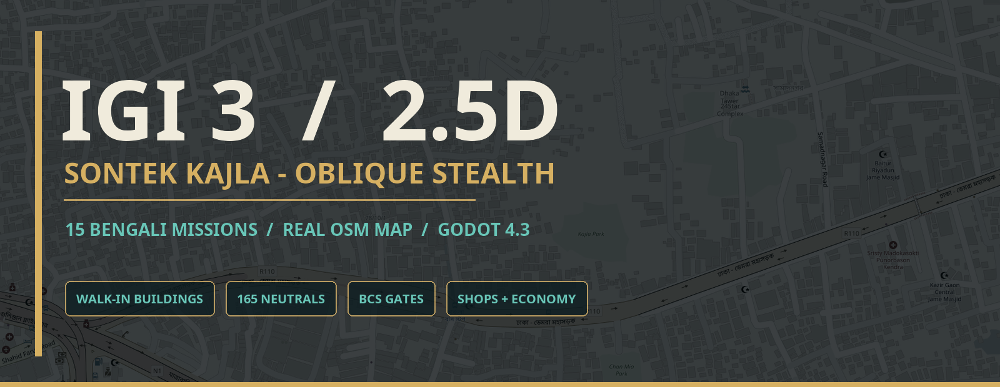
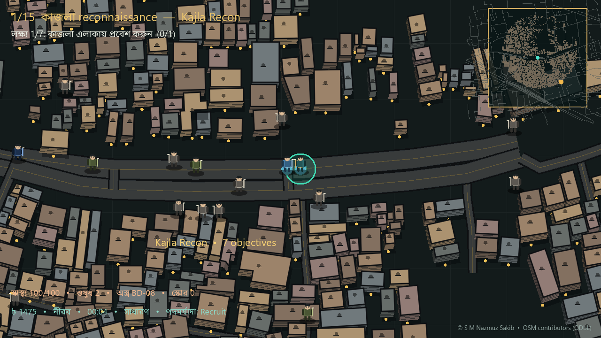
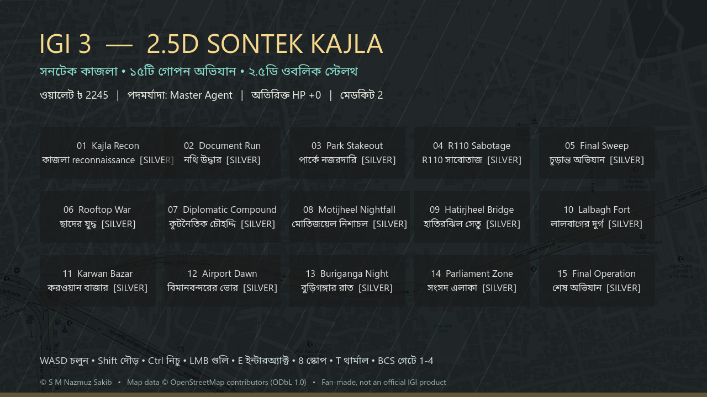
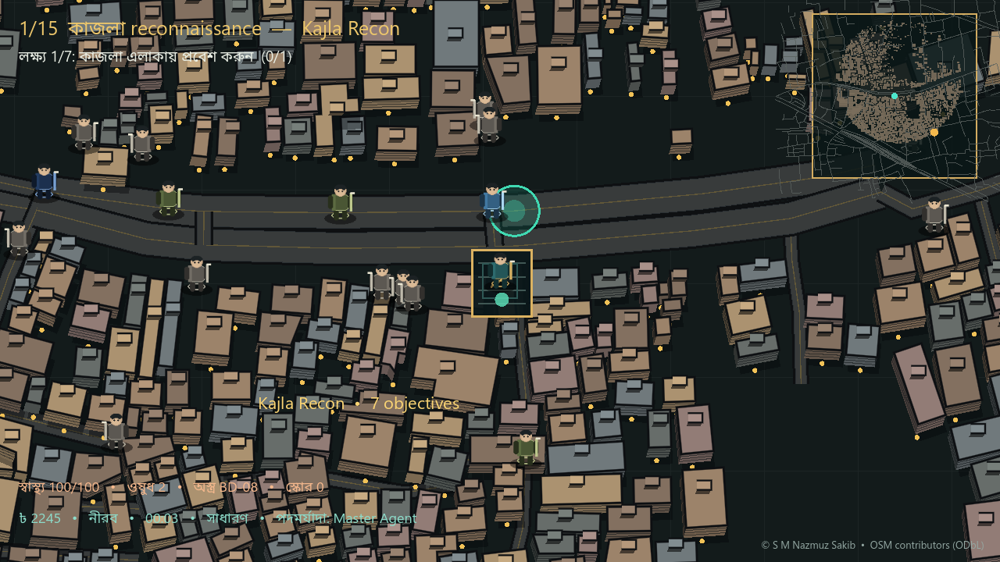
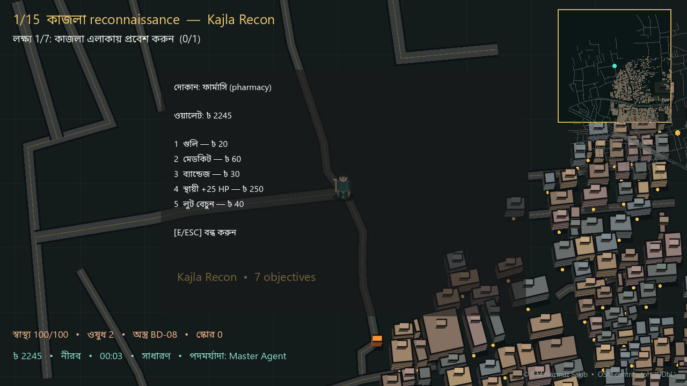
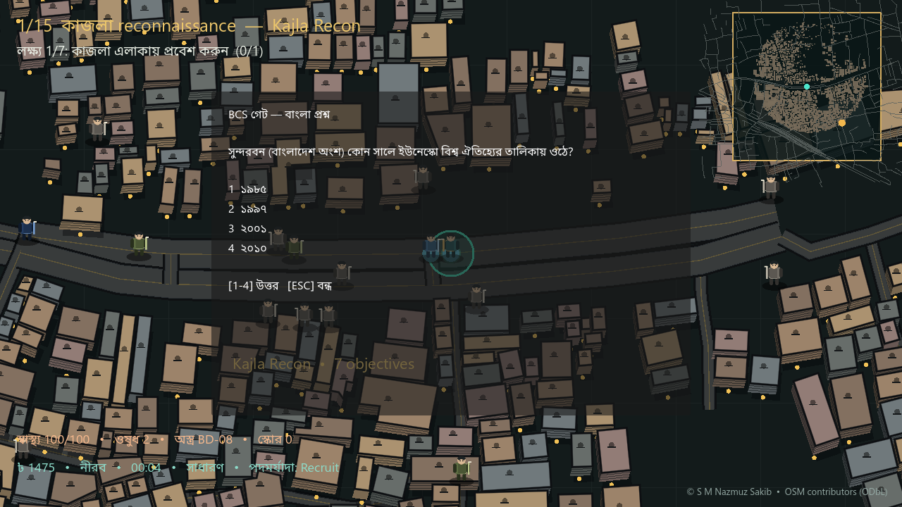
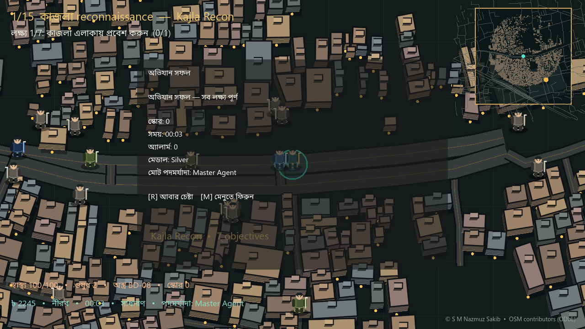
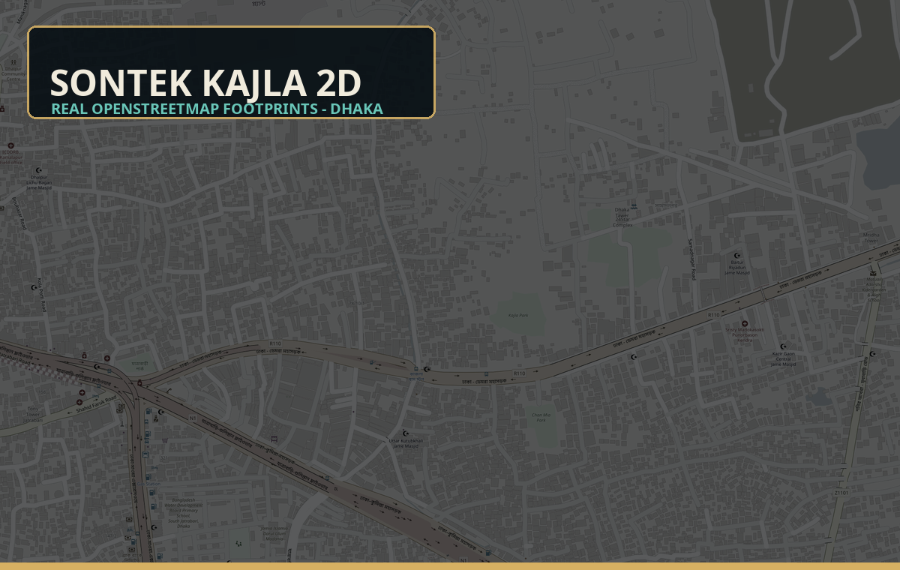

# IGI 3 2.5D — Sontek Kajla

[](https://github.com/Sakibpedia/igi3-2-5d/actions/workflows/build_exes.yml)



An **oblique 2.5D upgrade** of the IGI 3 Sontek Kajla campaign: real OSM buildings are drawn as extruded towers with walls, roof slabs, shadows, floor bands and rooftop huts. 15 Bengali stealth missions, Godot 4.3.



## Play

Download `IGI3_2_5D.exe` from the [Releases page](https://github.com/Sakibpedia/igi3-2-5d/releases) and double-click it. SmartScreen: **More info → Run anyway** (unsigned build).

## What is better than the flat 2D edition

- **Extruded OSM towers:** every footprint becomes a box with shaded front walls, a lighter roof, floor bands and a cast shadow; buildings are depth-sorted back-to-front.
- **Billboard characters:** front-facing human figures with ground shadows and depth ordering instead of flat top-down tokens.
- **2.5D props:** shops, BCS gates and vehicles are extruded boxes with highlights and shadows.
- **Same full campaign:** 15 missions, 7–9 objectives each, 1,500 buildings, 165 neutral actors, 200 civilians, 18 knife gangs, safe shops, wallet, BCS gates, medals and saves.
- All art is generated locally by `python tools/make_visuals.py` — no paid image service.

## Real gameplay screenshots

| Menu | Interior / roof | Shop |
|---|---|---|
|  |  |  |

| BCS gate | Result | OSM source map |
|---|---|---|
|  |  |  |

## Controls

```
WASD / arrows move   Shift sprint   Ctrl crouch   LMB fire   E interact / shop / gate / enter
8 scope (zoom)       T thermal      M map         R medkit   F bandage
BCS gate: 1-4        Shop: 1-5      ESC pause     Result: R retry, M menu
```

## Build and test

```powershell
godot --headless --path . --import
python tools/make_visuals.py
godot --headless --path . res://tools/test/CityTest.tscn
godot --headless --path . res://tools/test/SaveTest.tscn
powershell tools/test/run_all.ps1 -Godot "C:\path\to\Godot_v4.3-stable_win64_console.exe" -Deep
godot --headless --path . --export-release "Windows Desktop"
```

All suites print `PASS`. Full details: [docs/VERIFICATION.md](docs/VERIFICATION.md).

## Credits

Game code, design and generated art: **S M Nazmuz Sakib**.
Map data © [OpenStreetMap contributors](https://www.openstreetmap.org/copyright), ODbL 1.0.
Fonts: Noto Sans / Noto Sans Bengali (SIL OFL 1.1).
Made by S M Nazmuz Sakib. No open-source license is granted for the original work.
